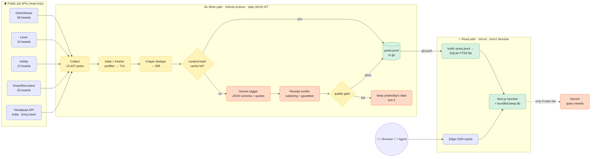
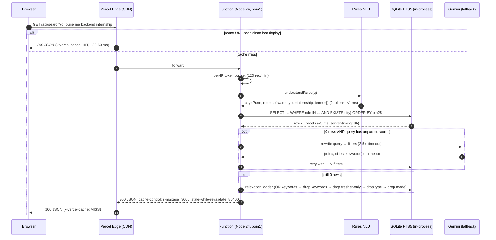
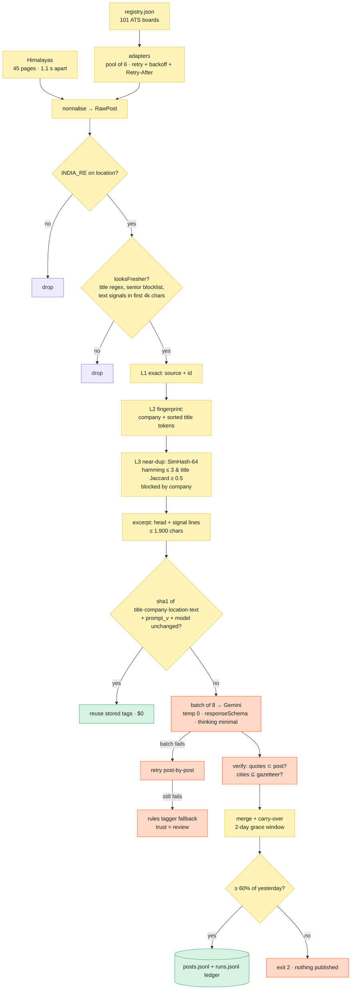
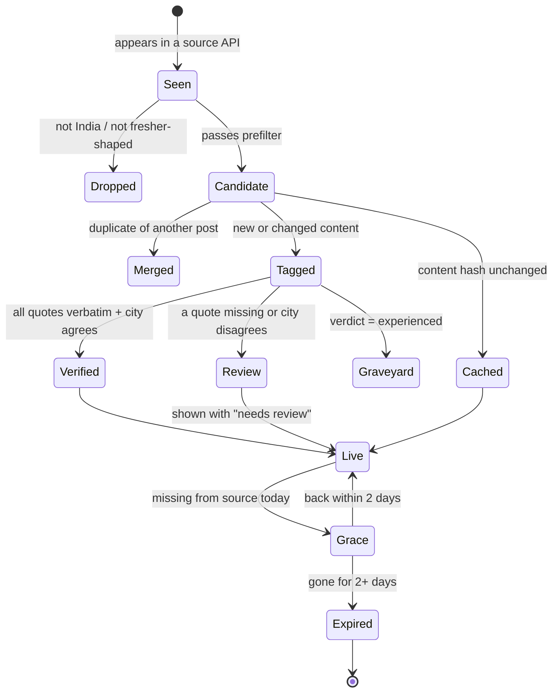
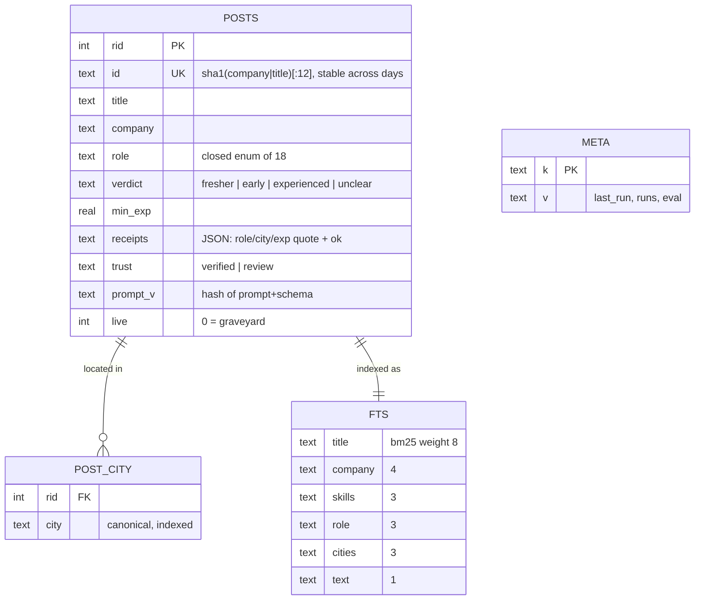
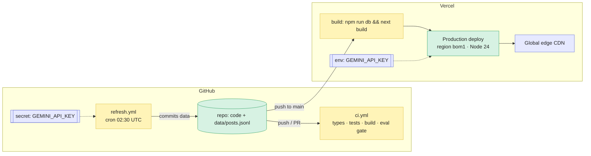

<div align="center">

# beep<span>.</span>

### Fresher jobs in India, tagged by AI, **with receipts.**

Every role, city and "fresher" tag ships with a **verbatim quote from the job post** that proves it.
Plain code checks that the quote is really in the post. **No quote, no tag.**

**[Live site → beep-jobs.vercel.app](https://beep-jobs.vercel.app)** · [Search jobs](https://beep-jobs.vercel.app/jobs) · [Public evals](https://beep-jobs.vercel.app/evals) · [AI view (`/llms.txt`)](https://beep-jobs.vercel.app/llms.txt)


</div>

---

## TL;DR: the two numbers that were asked for

| | Result | How it was measured |
|---|---|---|
| **Tagging accuracy** | **Role 94%** (95% CI 84–98%; strict single-label 88%) · **City 96%** (87–99%) · **Role AND city both right 92%** · Fresher verdict 94% | 50 posts hand-labelled **blind** (labels written before the model was run on them), on a **held-out set the prompt was never tuned on**. Stratified 25 first-party ATS + 25 aggregator posts, seeded draw. Every post and every miss is public on [`/evals`](https://beep-jobs.vercel.app/evals). |
| **Cost per 1,000 posts** | **$0.53** (production run) · $0.55 (eval run) | Real token counts from Gemini `usageMetadata` × Google's list price. Production run: 669 posts, 300,657 input + 104,537 output tokens = **$0.3515**. Re-tagging an unchanged post costs **$0** (content-hash cache), so a normal day costs cents. |

Rules-only baseline on the same 50 posts: role 58%. **The LLM buys +36 points of role accuracy for half a US cent per post.**

---

## The hero feature: Receipts

3,000 people are building "scrape jobs + LLM tags + search page". Every one of those boards asks users to **trust the AI**. Beep is built on the opposite idea: **an AI tag is a claim, and a claim needs evidence.**

```text
┌──────────────────────────────────────────┐
│ BEEP · TAG RECEIPT              #07A67D8D │
│ Social Media Intern · SWIGGY              │
│- - - - - - - - - - - - - - - - - - - - - -│
│ ROLE   Marketing, Content & Growth        │
│ ▌"Social Media Management: Assist in      │
│ ▌ managing Dineout Mag's social media…"  ✓│
│ CITY   Mumbai                             │
│ ▌"Mumbai, MH, India"                     ✓│
│ FRESHER?  True fresher · 0 yrs            │
│ ▌"relevant internship experience is      ✓│
│ ▌ welcome."                               │
│- - - - - - - - - - - - - - - - - - - - - -│
│ TRUST  VERIFIED · all quotes match        │
│ ||||| |||| | ||||| || |||| ||| | |||| ||  │
└──────────────────────────────────────────┘
```

How it works:

1. The LLM must return **a verbatim quote for each tag** (role, city, experience), enforced by a JSON schema.
2. **Deterministic code** checks each quote is a real substring of the post (after whitespace/quote normalisation). A hallucinated quote fails.
3. A second, **LLM-independent signal**, a city gazetteer over the structured location field, must agree with the LLM's cities.
4. Only posts that pass both get `trust: verified`. Everything else is shown as "needs review".

**Does the trust flag mean anything?** On the held-out set, `verified` posts scored **98% city / 96% role**. The one post that was not verified was wrong on both. (n = 1, so treat that as an anecdote, not a statistic.) Across all 150 evidence quotes in the held-out run, **150 were found verbatim**.

### Three more things nobody else will have

| Feature | What it does | Why it matters |
|---|---|---|
| **Fake-fresher detector** | Reads the *requirements*, not the title, and gives each post a verdict: `fresher` / `early` / `experienced` / `unclear`, with the quote. `experienced` posts are hidden and listed in a public [graveyard](https://beep-jobs.vercel.app/jobs?rejected=1). | 46 posts are in the graveyard today. 34 of them came from a feed already filtered to "Entry-level" by the job board itself, yet ask for 2+ years. A fresher should never see them. |
| **Hinglish search with a cost cascade** | `pune me backend internship chahiye` → `city=Pune, role=Software, type=internship`, parsed by **rules at 0 tokens**. The LLM is only called when rules fail, with a 2.5 s timeout, and the CDN caches the answer. | Most searches cost $0 and answer in milliseconds. If Gemini is down, search still works. |
| **Human \| AI toggle** | One click turns the landing page into a structured, skill-shaped markdown file (frontmatter, when-to-use, tool specs, schema, rules for agents). Also served at [`/llms.txt`](https://beep-jobs.vercel.app/llms.txt). | AI agents are a second audience. Beep is the job board an agent can actually use correctly. |

---

## System at a glance



**The core design decision:** the write path (expensive, slow, LLM-heavy, once a day) and the read path (cheap, fast, millions of times) **share nothing but a git commit.** The read path never calls a database server; the database is a 3.7 MB file shipped inside each function.

---

## Runtime topology: how one request travels



Measured on the live deploy: cache **HIT** on the second identical request, `server-timing: db;dur=3.5` for a FTS query, ~1.4 s for the rare query that needs the LLM fallback.

---

## Write path: the daily pipeline (LLD)



### Post lifecycle



### Data model



---

## The AI-native parts, in detail

| Concern | Decision | Why |
|---|---|---|
| Output shape | Gemini `responseSchema` with **closed enums** for role (18), city (33) and verdict (4) | The model cannot invent "Bangalore" vs "Bengaluru" or a new role. Normalisation is free. |
| Field order | `propertyOrdering` puts each `*_quote` **before** its label | The model commits to evidence first, then labels from it. A cheap chain-of-thought with no extra tokens. |
| Hallucination control | Verbatim-quote check + gazetteer cross-check | Turns invisible errors into a visible `review` flag. |
| Token diet | `excerpt()` keeps the first ~650 chars plus every line that mentions years, location, stipend, degree, etc. | Requirements often sit 3,000 chars deep under a company blurb. ~450 input tokens per post. |
| Batching | 8 posts per call, 3 calls in flight | Amortises the ~600-token system prompt. Batch failure falls back to single-post calls, then to rules. |
| Determinism | temperature 0, `thinkingLevel: minimal` | Reproducible tags, thinking tokens are billed as output and add nothing on this task. |
| Prompt as code | `PROMPT_V = sha1(prompt + schema)` stored on every tag | Any prompt change invalidates the cache and is traceable on `/evals`. |
| Evals as CI | `ci.yml` re-runs the held-out eval when `pipeline/tagger/**`, the taxonomy or golden files change, and fails below 80% role / 85% city | A prompt "improvement" that regresses can't ship. |
| Honest evaluation | Separate **dev** set (prompt tuned on it: role 98%) and **held-out** set (never tuned on: role 94%). Wilson 95% intervals. Strict and lenient role scores. | Reporting the dev number would overstate accuracy by 4 points. |
| Query understanding | rules → LLM → relaxation ladder | 0-token path for most queries; LLM only where it adds value; never an empty page. |

### What the prompt iteration looked like

Prompt v1 (`60354366`) scored **78% role** on the dev set. The misses were one systematic error: gig work that produces AI training data (annotation, speech recording, translation validation) was tagged as "Data Science & AI/ML". Prompt v2 (`20f64852`) added duty-based tie-break rules → **98% on dev**. The held-out set, labelled afterwards and never used for tuning, came in at **94%**: that is the number we report.

Remaining held-out misses (all visible on `/evals`):
- 2 boundary cases on the experience rule: "2+ years" / "2–4 years" tagged `experienced`, while the rule says a minimum of 2 is `early`.
- 1 location error: "Gift City" read as "Other" instead of Ahmedabad.
- 1 ambiguous role: a web designer tagged as Software.
- 1 extra city: Ahmedabad picked up from "Development Center: Ahmedabad" on a remote internship.

---

## Scalability, reliability, availability

### Why this design scales

| Load | What happens | Bottleneck | Answer |
|---|---|---|---|
| 1 → 10k req/s reads | CDN absorbs repeat queries; misses hit stateless functions, each with its own in-process SQLite | none shared | Functions scale horizontally; there is **no DB server to saturate** and no connection pool. |
| 700 → 100k posts | Pipeline time grows linearly; FTS5 file grows to ~500 MB | function bundle size (250 MB limit) | Move the index to Turso/libSQL replicas or Postgres + pg_trgm read replicas; the write/read contract (one artifact per day) stays the same. |
| Tagging cost at 100k new posts/day | $0.53 × 100 = **$53/day**; ~$27 with Gemini Batch API | LLM spend | Content-hash cache means only *new or changed* posts cost money; most days most posts are unchanged. |
| More sources | Add a slug to `registry.json` or a 20-line adapter | upstream politeness | Bounded concurrency per source, Retry-After honoured, failures isolated per board. |

### Failure modes and what the user sees

| Failure | Detection | Behaviour |
|---|---|---|
| A board 404s or times out | adapter catch, per-board | That board is skipped; others continue. |
| A whole source fails (>50% boards error) | `failedSources` | Its posts from yesterday are carried over, not expired. |
| Gemini 429 / 5xx | HTTP status | Exponential backoff + jitter (5 tries) → single-post retry → rules fallback with `trust: review`. The run never fails because of the LLM. |
| Model returns garbage / invents a quote | schema + `verify()` | Post marked `review`, visible to users. |
| Pipeline yields < 60% of yesterday's posts | quality gate | Exit 2, nothing committed; **yesterday's site stays live**. |
| Refresh did not land for 36 h | `/api/health` → `stale: true` | Point an uptime monitor at it; site keeps serving the last good data. |
| Vercel build fails | Vercel keeps the previous deployment | No downtime: immutable deploys, atomic switch. |
| Search LLM fallback down | 2.5 s timeout | Rules result returned; search is never blocked on the LLM. |
| Abuse of the LLM fallback | per-IP token bucket + CDN cache | 429 after 120 req/min per instance. |

**Availability story:** the read path has exactly one runtime dependency, the Vercel platform. No database, no queue, no cache cluster and no LLM is required to serve a search. Data is versioned in git, so any bad day can be reverted with `git revert` and a redeploy.

---

## Deployment topology



- **Region `bom1` (Mumbai)**: the users are in India.
- **Concurrency group** on the refresh job: two writers can never race.
- **Immutable deploys**: every data refresh is a new deploy; the CDN cache is invalidated atomically.

---

## Engineering decisions (short ADRs)

1. **SQLite FTS5 baked into the deploy instead of Postgres/Elasticsearch.** Data changes once a day and is <5 MB. A file read beats any network hop, costs $0 and cannot go down separately. Revisit at ~100k posts.
2. **Git as the system of record.** Every daily snapshot is diffable, reviewable and revertible; the run ledger (`data/runs.jsonl`) is an audit log of cost and quality.
3. **Public APIs only.** Slower to reach volume than scraping, but nothing breaks when a site changes its HTML, and nothing violates anyone's terms. See [`docs/COMPLIANCE.md`](docs/COMPLIANCE.md).
4. **`gemini-3.5-flash-lite` over a bigger model.** Held-out 94% role / 96% city at $0.53 per 1,000. A bigger model would need to beat that by enough to justify ~2.5× the price; the eval harness makes that a one-command experiment (`BEEP_MODEL=… npm run eval`).
5. **Closed taxonomy, 18 roles.** Fine enough to be useful for a fresher, coarse enough that two humans mostly agree.
6. **No Batch API.** It halves cost but adds up to hours of latency to a daily job and a second code path. Worth it only at much larger volume.

---

## Run it yourself

```bash
git clone https://github.com/vinitpatil519/beep && cd beep
npm ci
cp .env.example .env              # add GEMINI_API_KEY
npm run pipeline                  # collect → dedupe → tag → verify → data/posts.jsonl
npm run eval -- holdout           # score the tagger on the 50 held-out posts
npm test                          # unit tests (dedupe, receipts, NLU, prefilter)
npm run dev                       # http://localhost:3000
```

| Command | What it does |
|---|---|
| `npm run pipeline` | Full daily refresh; idempotent; second run on the same day costs $0. |
| `npm run eval -- holdout` / `-- dev` | Accuracy + cost on a golden set, writes `data/eval-*.json`, exits 1 below the gate. |
| `npm run golden:sample -- <seed> <exclude files…>` | Reproducible stratified sample for new labels. |
| `npm run db` | Build `data/beep.db` from `posts.jsonl`. |

## Repository layout

```
pipeline/
  sources/        public API adapters + board registry
  dedupe.ts       exact → fingerprint → SimHash
  tagger/         prompt, schema, Gemini client, verifier, rules fallback
  run.ts          daily orchestrator + quality gate + ledger
  eval.ts         golden-set scoring with Wilson CIs and rules baseline
  build-db.ts     posts.jsonl → SQLite FTS5
lib/              search, query understanding cascade, taxonomy, agent markdown
app/              Next.js: landing (/), jobs (/jobs), evals (/evals), APIs, /llms.txt
components/       Landing (GSAP + Lenis), JobsApp, Receipt
data/             posts.jsonl, runs.jsonl, golden.{dev,holdout}.jsonl, eval-*.json
docs/             COMPLIANCE.md
```

## Honest limitations

- **Who labelled the golden set.** The 100 labels were written by an AI assistant reading each post blind (without seeing model output), not yet by a second human. Inter-annotator agreement is unmeasured; a human pass over `data/golden.holdout.jsonl` is the first thing to do next.
- **n = 50.** The 95% interval on 94% is 84–98%.
- **Source mix.** ~90% of live posts come from the Himalayas API (remote-from-India roles); first-party ATS boards contribute fewer, city-specific roles. Adding more Indian company boards to `registry.json` is the cheapest way to grow city coverage.
- **"Remote" is a city.** It is a pseudo-city in the taxonomy so remote jobs are filterable alongside real cities.

---

<div align="center">
<sub>Built with Next.js 16, GSAP, Lenis, node:sqlite FTS5, Gemini and GitHub Actions. Jobs data from public APIs of Greenhouse, Lever, Ashby, SmartRecruiters and <a href="https://himalayas.app">Himalayas</a>.</sub>
</div>
